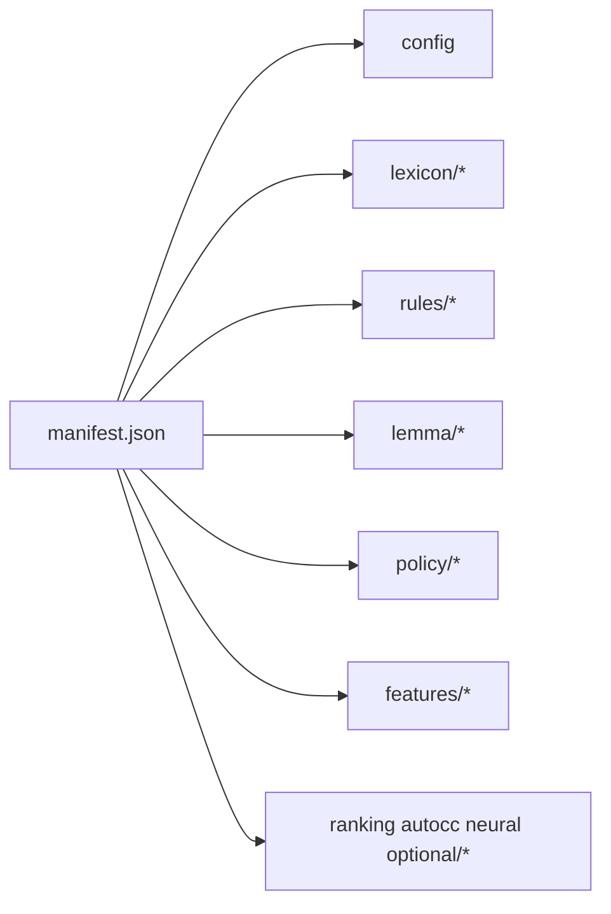

# HOSDICT Spec v1

Status: working design for implementation start  
Source basis: reverse reports in `reverse/` and extracted assets in `entry/src/main/resources/rawfile/dict/`

## Goal
`hosdict` v1 is a normalized package format for a HarmonyOS keyboard engine. It preserves the semantic layers already recovered from the Yandex container, but it does not copy the original binary container layout.

The format must support three realities at once:

1. default production assets such as `trie` and `rules.bin`,
2. experimental families such as `KEYBOARD-13421_*`,
3. progressive decoding where some families are still opaque/stub-loaded in v1.



## Design principles

| Principle | Decision |
| --- | --- |
| Semantic preservation | Keep lexicon, transfeme rules, normdict, lemma, policy, and feature configs as separate modules. |
| No byte-for-byte cloning | Original TOC offsets and aligned pages are not part of the public `hosdict` contract. |
| Family-based loading | `succinct_lexicon_v1`, `succinct_lexicon_k13421`, `tfmtrie_v1`, `tfmtrie_k13421`, `normdict_v2`, `chd_hash`, `lemma_rules_program`, `policy_blob`, and `feature_json` are first-class family ids. |
| Progressive decode | A loader may validate and stage an asset even before semantic decoding is complete. |
| HarmonyOS-friendly | Package layout must be easy to ship via `rawfile/`, copy to app storage, and open through a native C++ engine behind Node-API. |

## Recommended package layout

```text
hosdict/
  manifest.json
  config/
    container_config.json
  lexicon/
    trie.bin
    k13421_trie.bin
  rules/
    transfeme_trie.bin
    transfeme_k13421.bin
  lemma/
    lemmer_mhash.bin
    lemmer_rules.bin
  policy/
    blacklist.bin
    blacklist_suggest.bin
    autocorrect_blocker.bin
    abbr.bin
  features/
    features_autocc.json
    features_ranker.json
    features_tap_model.json
    features_ranker_swipe.json
    features_ranker_swipe_backoff.json
    features_swipe_blocker.json
  ranking/
    ranker.bin
    ranker_swipe.bin
    ranker_swipe_backoff.bin
    tap_model_ranker.bin
    tap_model_classifier.bin
    swipe_blocker.bin
  autocc/
    tree_autocorrect_model.bin
    k13321_autocc.bin
    k13421_autocc.bin
  neural/
    neural_model.bin
    k13321_nnlm_model.bin
    ms_models/
    gguf/
  emoji/
    emoji_model.bin
    search_emoji_model.bin
  speech/
    rnnt_model.bin
```

## Manifest schema

### Root object

```json
{
  "manifest_version": "hosdict.manifest/v1",
  "engine_abi": "hoskey.engine/v1",
  "package": {
    "name": "ru.smart.default",
    "locale": "ru-RU",
    "description": "Smart Russian keyboard package",
    "source": "reverse-based reconstruction",
    "created_at": "2026-03-25"
  },
  "config": { "format": "feature_json", "path": "config/container_config.json", "required": true },
  "lexicon": {
    "default": { "format": "succinct_lexicon_v1", "path": "lexicon/trie.bin", "required": true },
    "experiments": {
      "KEYBOARD-13421_v2": { "format": "succinct_lexicon_k13421", "path": "lexicon/k13421_trie.bin", "required": false }
    }
  },
  "rules": {
    "transfeme_default": { "format": "tfmtrie_v1", "path": "rules/transfeme_trie.bin", "required": true },
    "transfeme_experiments": {
      "KEYBOARD-13421_v2": { "format": "tfmtrie_k13421", "path": "rules/transfeme_k13421.bin", "required": false }
    }
  },
  "normdict": { "format": "normdict_v2", "path": "lexicon/normdict.bin", "required": true },
  "lemma": {
    "hash": { "format": "chd_hash", "path": "lemma/lemmer_mhash.bin", "required": true },
    "rules": { "format": "lemma_rules_program", "path": "lemma/lemmer_rules.bin", "required": true }
  },
  "policy": {
    "blacklist": { "format": "policy_blob", "path": "policy/blacklist.bin", "required": true },
    "blacklist_suggest": { "format": "policy_blob", "path": "policy/blacklist_suggest.bin", "required": false },
    "autocorrect_blocker": { "format": "policy_blob", "path": "policy/autocorrect_blocker.bin", "required": true },
    "abbr": { "format": "policy_blob", "path": "policy/abbr.bin", "required": false }
  },
  "features": {
    "autocc": { "format": "feature_json", "path": "features/features_autocc.json", "required": true },
    "ranker": { "format": "feature_json", "path": "features/features_ranker.json", "required": true },
    "tap_model": { "format": "feature_json", "path": "features/features_tap_model.json", "required": true }
  },
  "optional": {
    "ranking": {},
    "autocc": {},
    "neural": {},
    "emoji": {},
    "speech": {}
  }
}
```

### `AssetDescriptor` contract

Every asset object in the manifest uses the same descriptor shape.

| Field | Type | Required | Meaning |
| --- | --- | --- | --- |
| `format` | string | yes | Loader family id. |
| `path` | string | yes | Relative path inside package root. |
| `required` | bool | yes | Hard failure on missing asset if `true`. |
| `role` | string | no | Human-readable semantic role. |
| `experiment` | string | no | Experiment label such as `KEYBOARD-13421_v2`. |
| `compression` | string | no | `none` by default. Reserve for future repacks. |
| `sha256` | string | no | Optional integrity hash. |
| `size` | integer | no | Optional expected byte size. |
| `tags` | string[] | no | Stage tags such as `smart-v1`, `ranking`, `optional`. |
| `notes` | string | no | Reverse-specific comments. |

## Required sections for v1

### `config`
Stores the recovered top-level routing and predictor policy JSON. It is the bootstrap policy layer, not just metadata.

### `lexicon.default`
Default succinct lexicon family loaded for v1 smart suggestions.

### `lexicon.experiments.*`
Separate lexicon families that must not be merged with default until decoder parity is proven.

### `rules.transfeme_default`
Default `rules.bin` family. Current working assumption: serialized transformation-rule trie (`TfmTrie`).

### `rules.transfeme_experiments.*`
Experimental transfeme-rule families such as `KEYBOARD-13421_rules.bin`.

### `normdict`
Dedicated normalization dictionary. Self-described as `NormDictionary` in the extracted asset.

### `lemma.hash`
CHD/perfect-hash-like lookup structure from `lemmer_mhash`.

### `lemma.rules`
Separate morphology/lemma rule program from `lemmer_rules`.

### `policy.*`
Compact binary policy blobs. At minimum preserve:
- `blacklist`
- `blacklist_suggest`
- `autocorrect_blocker`
- `abbr`

### `features.*`
JSON feature specifications that drive smart behavior. At minimum preserve:
- `features_autocc.json`
- `features_ranker.json`
- `features_tap_model.json`

## Optional sections for later stages

| Section | Purpose | Earliest stage |
| --- | --- | --- |
| `optional.ranking.*` | ranker, swipe rankers, tap model rankers, blockers | Smart v2 |
| `optional.autocc.*` | tree autocc and experimental autocc models | Smart v2 |
| `optional.neural.*` | NNLM, MindSpore, GGUF assets | Later |
| `optional.emoji.*` | emoji ranking / search assets | Later |
| `optional.speech.*` | RNNT and voice-related assets | Later |

## Validation rules

1. Exactly one `lexicon.default` and one `rules.transfeme_default` must exist.
2. `lemma.hash` and `lemma.rules` must either both exist or both be absent.
3. A package claiming `smart-v1` must include:
   - `config`
   - `lexicon.default`
   - `rules.transfeme_default`
   - `normdict`
   - `lemma.hash`
   - `lemma.rules`
   - `policy.blacklist`
   - `policy.autocorrect_blocker`
   - `features.autocc`
   - `features.ranker`
   - `features.tap_model`
4. Experimental assets must live under explicit experiment keys and must not silently replace defaults.
5. Unknown top-level sections must be preserved by converters for forward compatibility.
6. The manifest contract is semantic; it does not expose original container offsets.

## Mapping from current extracted asset names

| Extracted name | `hosdict` path | Family |
| --- | --- | --- |
| `trie` | `lexicon/trie.bin` | `succinct_lexicon_v1` |
| `KEYBOARD-13421_trie` | `lexicon/k13421_trie.bin` | `succinct_lexicon_k13421` |
| `rules.bin` | `rules/transfeme_trie.bin` | `tfmtrie_v1` |
| `KEYBOARD-13421_rules.bin` | `rules/transfeme_k13421.bin` | `tfmtrie_k13421` |
| `normdict` | `lexicon/normdict.bin` | `normdict_v2` |
| `lemmer_mhash` | `lemma/lemmer_mhash.bin` | `chd_hash` |
| `lemmer_rules` | `lemma/lemmer_rules.bin` | `lemma_rules_program` |
| `blacklist` | `policy/blacklist.bin` | `policy_blob` |
| `blacklist_suggest` | `policy/blacklist_suggest.bin` | `policy_blob` |
| `autocorrect_blocker` | `policy/autocorrect_blocker.bin` | `policy_blob` |
| `abbr` | `policy/abbr.bin` | `policy_blob` |
| `features_autocc.json` | `features/features_autocc.json` | `feature_json` |
| `features_ranker.json` | `features/features_ranker.json` | `feature_json` |
| `features_tap_model.json` | `features/features_tap_model.json` | `feature_json` |

## Implementation note

The first converter does not need byte-perfect decoders for every family. It only needs to:

1. stage assets under normalized paths,
2. emit a valid manifest,
3. attach family ids and required/optional flags,
4. preserve separate default vs experimental families.
