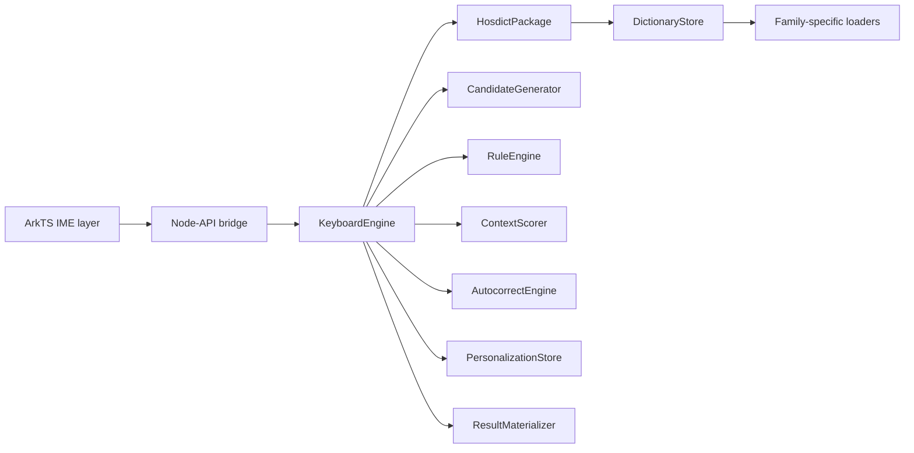
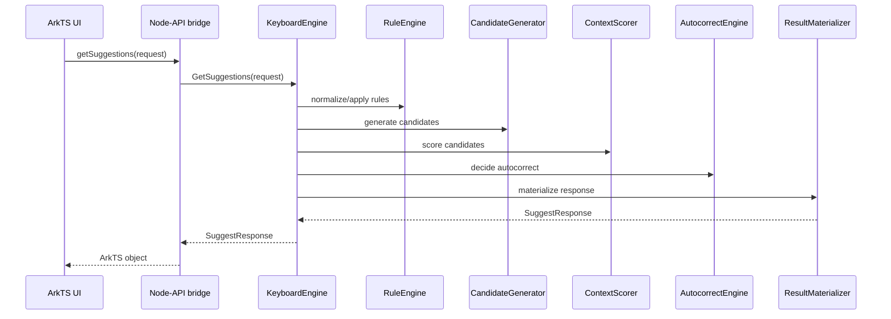

# HOSKEY Engine Architecture

Status: architecture baseline for implementation start

## Scope
This document defines the first native engine architecture for HOSKEY. It is intentionally narrower than the original Yandex runtime.

It focuses on:
- `hosdict` package loading,
- smart-v1 suggestion flow,
- a stable internal C++ API,
- a thin ArkTS/HarmonyOS bridge.

It explicitly does **not** try to reproduce ASR, swipe, emoji, secure logging, or neural parity in the first implementation.

## Top-level architecture



## Module decomposition

### Mandatory package/data modules

| Module | Responsibility | Input | Output |
| --- | --- | --- | --- |
| `DictionaryStore` | In-memory registry of loaded assets and parsed metadata | loader outputs | asset lookup by key/family |
| `LexiconLoader` | Validate and stage succinct lexicon families | `succinct_lexicon_*` asset | opaque lexicon payload + header facts |
| `TransfemeRuleLoader` | Validate and stage transfeme rule families | `tfmtrie_*` asset | opaque/stub-decoded rule payload |
| `NormDictLoader` | Stage normalization dictionary | `normdict_v2` asset | normdict payload + meta markers |
| `LemmerLoader` | Stage `lemmer_mhash` + `lemmer_rules` as paired resources | `chd_hash`, `lemma_rules_program` | paired lemma bundle |
| `PolicyLoader` | Stage policy blobs | `policy_blob` assets | per-policy binary payloads |
| `FeatureConfigLoader` | Read JSON feature configs and expose section/feature hints | `feature_json` assets | parsed feature documents |

### Runtime modules

| Module | Responsibility | Notes |
| --- | --- | --- |
| `CandidateGenerator` | Produce base candidate list from current token/context | Starts with lexicon + rule-driven expansion hooks |
| `ContextScorer` | Score/rank candidates using context and loaded feature configs | v1 may stay heuristic while preserving API shape |
| `AutocorrectEngine` | Decide whether and how to autocorrect | Must consult blocker policy and feature configs |
| `RuleEngine` | Apply transfeme and normalization logic | Keeps `rules.bin`, `normdict`, lemma resources separate |
| `PersonalizationStore` | Local per-user state and blacklist/autocorrect memory | Stub in v1, real store later |
| `ResultMaterializer` | Convert internal candidate graph into stable response objects | Should preserve useful field names from recovered contract |

### API layer

| Module | Responsibility |
| --- | --- |
| `HosdictPackage` | Open package root, validate manifest, coordinate loaders |
| `KeyboardEngine` | Main engine facade used by bridge and tests |
| `SuggestRequest` / `SuggestResponse` | Stable typed request/response contract |
| `CheckWordRequest` / `CheckWordResponse` | Word-validation contract |

## Runtime request flow



## Internal object model

| Object | Purpose |
| --- | --- |
| `HosdictManifest` | Package contract with explicit family ids and asset descriptors |
| `AssetDescriptor` | One manifest asset entry |
| `LoadedBinaryAsset` | Opaque bytes + metadata for staged binary families |
| `LoadedFeatureConfig` | Raw JSON + extracted feature/section hints |
| `Suggestion` | Stable candidate object with `text`, `type_flags`, `group_id`, `tag`, `additional_forms`, `score` |
| `SuggestResponse` | `suggestions`, `will_autocorrect`, `autocorrect_features`, `emojis`, `is_blocked` |

## HarmonyOS / ArkTS bridge plan

The HarmonyOS side should remain thin.

### ArkTS responsibilities

1. IME lifecycle handling through `InputMethodExtensionAbility`.
2. `inputMethodEngine.getInputMethodAbility().on('inputStart', ...)` registration and panel management.
3. Dictionary package installation from `rawfile/dict/` into `filesDir`.
4. Calling the native module with typed request objects.

Relevant HarmonyOS docs already confirm:
- `InputMethodExtensionAbility` is the correct extension type for IME applications.
- `inputMethodEngine.getInputMethodAbility()` is the modern IME runtime entry.
- Node-API (`napi`) is the correct native bridge layer, with `napi_add_finalizer`, async work, and threadsafe-function facilities available when needed.

### Native bridge responsibilities

| Bridge responsibility | Decision |
| --- | --- |
| Engine lifetime | One `KeyboardEngine` instance per installed package/session |
| Open call | `open(packageRoot)` or `open(manifestPath)` |
| Suggest call | `getSuggestions(request)` returns typed object, not raw protobuf bytes |
| Check call | `checkWord(request)` |
| Diagnostics | Optional `getDiagnostics()` or embedded status strings in development builds |

### Async model

- **v1**: keep `getSuggestions` synchronous while runtime is lightweight and parsers are still stubbed.
- **v2**: move scoring/autocorrect work behind `napi_create_async_work` if latency grows.
- **later**: if background ranking/personalization is introduced, use threadsafe function patterns instead of touching ArkTS from worker threads.

## Directory proposal

```text
entry/src/main/cpp/
  napi_bridge/
  hosdict_engine/
    asset_manifest.*
    loaders.*
    hosdict_package.*
    keyboard_engine.*
    status.h
docs/
  HOSDICT_SPEC_V1.md
  HOSKEY_ENGINE_ARCHITECTURE.md
  LOADER_INTERFACES.md
  IMPLEMENTATION_STAGES.md
  ENGINE_ABI_PLAN.md
tools/
  hosdict_converter/
```

## Non-goals for this phase

- No JNI bootstrap emulation.
- No attempt to keep the original `libjni_ykeyboard3.so` process model.
- No broad reverse of unrelated `.so` subsystems.
- No ASR, GGUF, or speech runtime in smart-v1.

## Decision summary

1. `hosdict` is the stable package boundary.
2. `KeyboardEngine` is the stable runtime boundary.
3. Node-API is the stable HarmonyOS bridge boundary.
4. Default and experimental asset families stay separate in both manifest and loader code.
